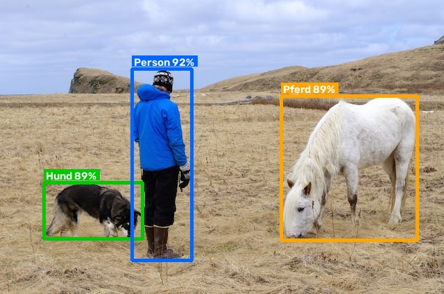

# yi-detector – Personen & Tiere mit farbigen Rahmen

Erkennt im Bild deiner YI-Hack-Tiz-Kameras **Personen (blauer Rahmen)** und **Hunde (grüner Rahmen)**, dazu Katzen (orange) und auf Wunsch weitere Tiere – **auch wenn sie sich nicht bewegen**.



## Warum ein eigener Dienst?

Die Kamera hat ca. 64 MB RAM und einen schwachen ARM-Kern – ein neuronales Netz läuft darauf nicht, und sie kann keine Rahmen ins Video zeichnen. Ihre eingebaute KI-Erkennung reagiert nur auf **Bewegung** und liefert keine Rahmen.

yi-detector läuft deshalb auf einem Rechner im Heimnetz (Home Assistant, NAS, Mini-PC, Raspberry Pi 4/5):

1. holt das Kamerabild (RTSP-Substream oder Snapshot),
2. lässt **YOLOv8n** auf **jedes** abgetastete Bild laufen – auf das ganze Bild, nicht nur auf bewegte Stellen. Darum wird eine still sitzende Person oder ein schlafender Hund genauso erkannt,
3. zeichnet die Rahmen (Farben frei wählbar),
4. stellt das Ergebnis bereit als
   * Live-MJPEG-Stream: `http://SERVER:8090/<kamera>/stream.mjpg`
   * Bild: `http://SERVER:8090/<kamera>/snapshot.jpg`
   * JSON: `http://SERVER:8090/<kamera>/status.json` (Objekte, Rahmen, Anzahl)
   * Übersicht aller Kameras: `http://SERVER:8090/`
   * **MQTT mit Home-Assistant-Auto-Erkennung:** pro Kamera Sensoren *Person*, *Hund*, *Katze* (an/aus + Anzahl) und eine Kamera *Erkennung* mit dem Bild inkl. Rahmen.

Leistung (YOLOv8n, 640 px): ca. 30–80 ms pro Bild auf einem aktuellen x86-Mini-PC, ca. 300–600 ms auf einem Raspberry Pi 4. Ein Bild pro Sekunde pro Kamera ist auch auf kleinen Rechnern gut machbar.

## Installation

### A) Home Assistant Add-on

1. *Einstellungen → Add-ons → Add-on Store → ⋮ → Repositories* → `https://github.com/tzureig/YI-Hack-Tiz`
2. **YI Detector** installieren, unter *Konfiguration* die Kameras eintragen, starten.
3. Mit dem Mosquitto-Add-on erscheinen die Sensoren automatisch. Die Weboberfläche öffnet sich über *Web-UI öffnen*.

### B) Docker / docker compose (NAS, Server, Pi)

```sh
mkdir yi-detector && cd yi-detector
curl -O https://raw.githubusercontent.com/tzureig/YI-Hack-Tiz/main/detector/docker-compose.yml
curl -o config.yaml https://raw.githubusercontent.com/tzureig/YI-Hack-Tiz/main/detector/config.example.yaml
nano config.yaml          # Kameras, MQTT eintragen
docker compose up -d
```

Das fertige Image `ghcr.io/tzureig/yi-detector` (amd64 + arm64) baut GitHub Actions automatisch. Selbst bauen: in `docker-compose.yml` `build: .` statt `image:` verwenden.

### C) Ohne Docker

```sh
pip install -r requirements.txt
# Modell einmalig exportieren
pip install ultralytics && yolo export model=yolov8n.pt format=onnx imgsz=640 opset=12
MODEL=./yolov8n.onnx python detector.py -c config.yaml
# Test mit einem Bild:
MODEL=./yolov8n.onnx python detector.py --image foto.jpg   # -> foto_detected.jpg
```

## Konfiguration

Siehe [config.example.yaml](config.example.yaml). Wichtig:

| Option | Bedeutung |
| --- | --- |
| `cameras[].url` | `rtsp://USER:PASS@IP/ch0_1.h264` (Substream, empfohlen) oder `http://IP/cgi-bin/snapshot.sh?res=high` |
| `cameras[].interval` | Sekunden zwischen zwei Erkennungen (Standard 1) |
| `cameras[].off_delay` | so lange bleibt „erkannt“ nach dem letzten Treffer an (Standard 10 s) – verhindert Flackern |
| `cameras[].objects` | Liste der Objekte nur für diese Kamera, z. B. `[person, dog]` |
| `objects.<name>.color` | Rahmenfarbe als RGB, z. B. Blau `[0, 102, 255]`, Grün `[0, 200, 0]` |
| `objects.<name>.min_score` | Mindest-Sicherheit 0…1 (Standard 0.5) |

Erkennbar sind alle 80 COCO-Klassen, z. B. `person, dog, cat, bird, horse, sheep, cow, car, bicycle`.

## In Home Assistant anzeigen

* **Mit MQTT:** Entität `camera.<kamera>_erkennung_erkennung` als Bildkarte; Automationen auf `binary_sensor.<kamera>_erkennung_person` / `binary_sensor.<kamera>_erkennung_hund`.
* **Ohne MQTT:** Integration *MJPEG IP Camera* → `http://SERVER:8090/<kamera>/stream.mjpg`.

Beispiel-Automation:

```yaml
automation:
  - alias: Hund im Garten
    trigger:
      - platform: state
        entity_id: binary_sensor.garten_erkennung_hund
        to: "on"
    action:
      - service: notify.mobile_app_handy
        data:
          message: "Hund im Garten erkannt"
          data:
            image: /api/camera_proxy/camera.garten_erkennung_erkennung
```

## Zusammen mit Frigate

Frigate erkennt ebenfalls Personen/Hunde und verfolgt stehende Objekte weiter, die Rahmenfarben sind dort aber fest. Wer Frigate nutzt, kann yi-detector parallel betreiben – am besten mit Frigates Restream als Quelle (`rtsp://FRIGATE:8554/garten_sub`), dann hat die Kamera nur eine Verbindung.

## Lizenz

yi-detector: GPL-3.0. Das Modell YOLOv8n stammt von Ultralytics (AGPL-3.0) und wird beim Bauen des Images heruntergeladen.
